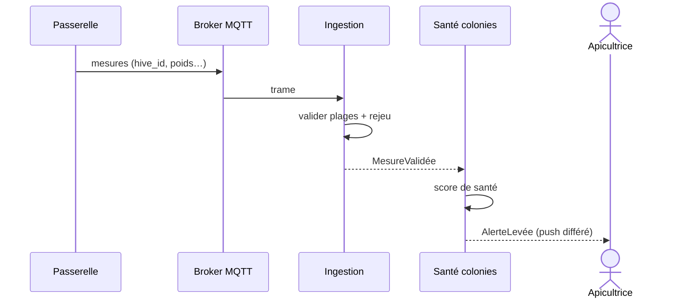
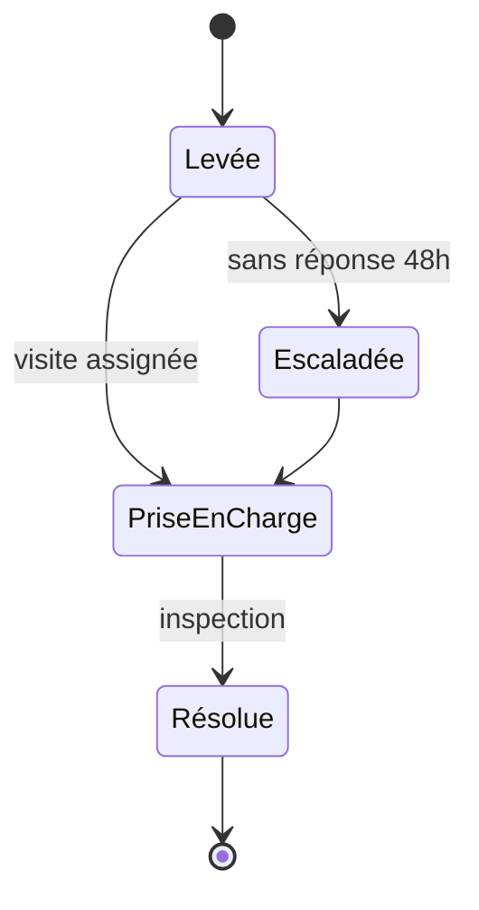

# QueenBee · diagrammes UML de l'alerte (Mermaid)

S'affiche dans VS Code (extension « Markdown Preview Mermaid Support »), sur GitHub/GitLab ou sur https://mermaid.live

## Séquence : de la mesure à l'alerte

## États : cycle de vie d'une alerte (agrégat Alerte, kit du TP 5)

