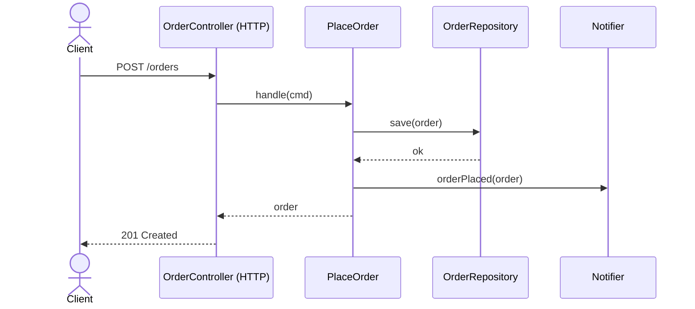
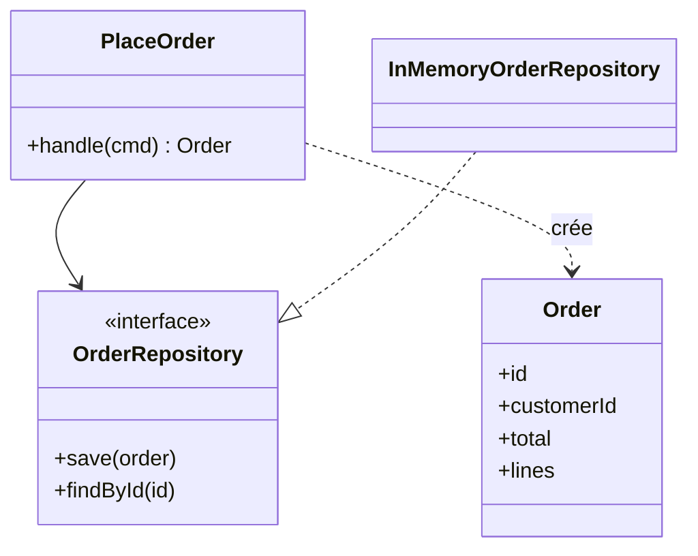
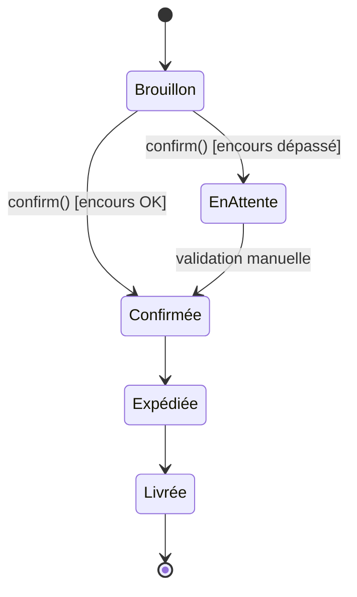

# Diagrammes UML du module Commande (Mermaid)

Ce fichier s'affiche directement sous forme de diagrammes sur GitHub/GitLab,
dans VS Code (extension « Markdown Preview Mermaid Support ») ou sur https://mermaid.live

## Séquence : passer une commande

## Classes : le cœur hexagonal

## États : cycle de vie d'une commande

